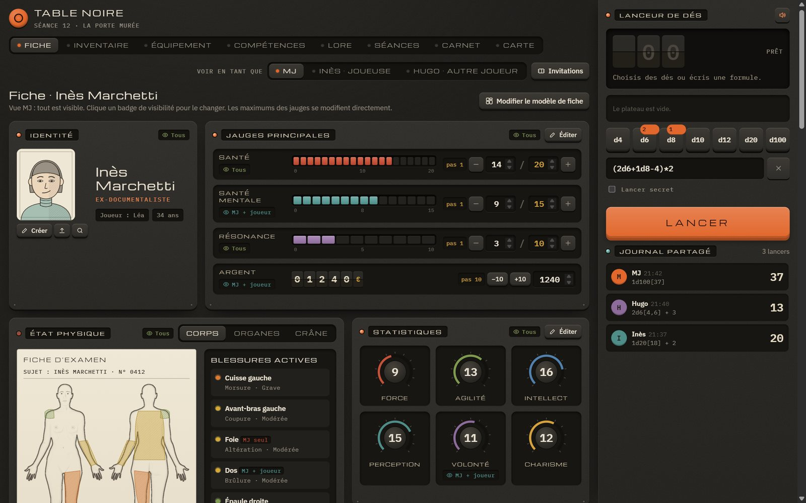
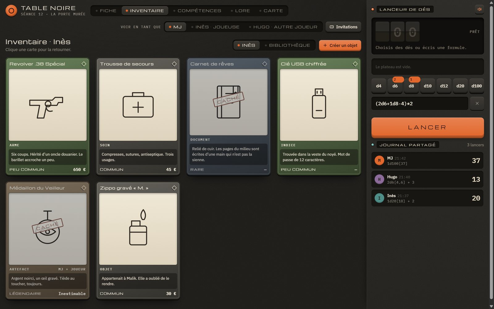
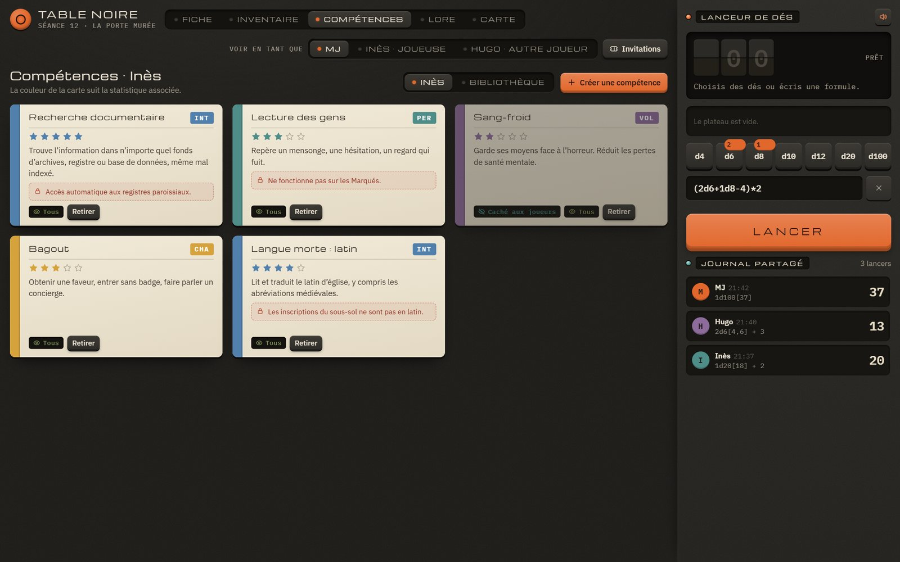
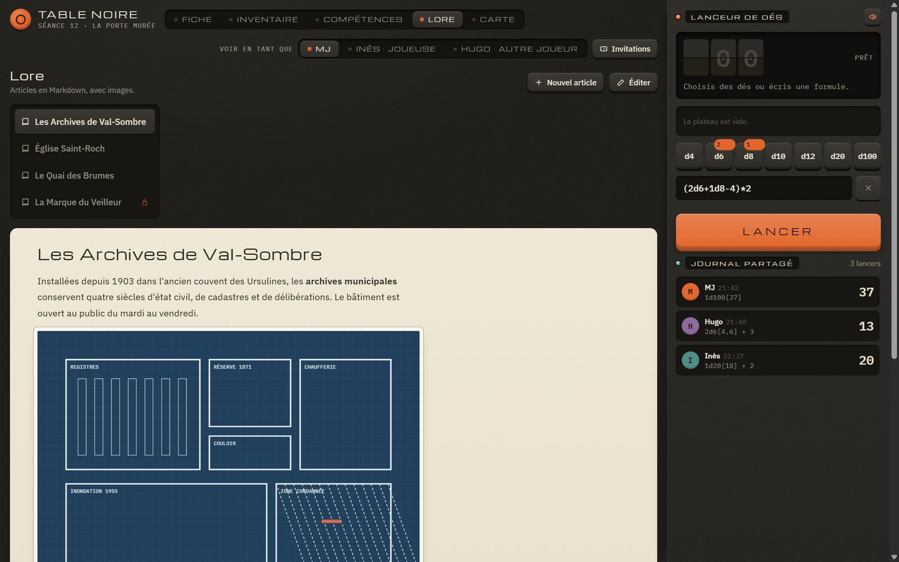
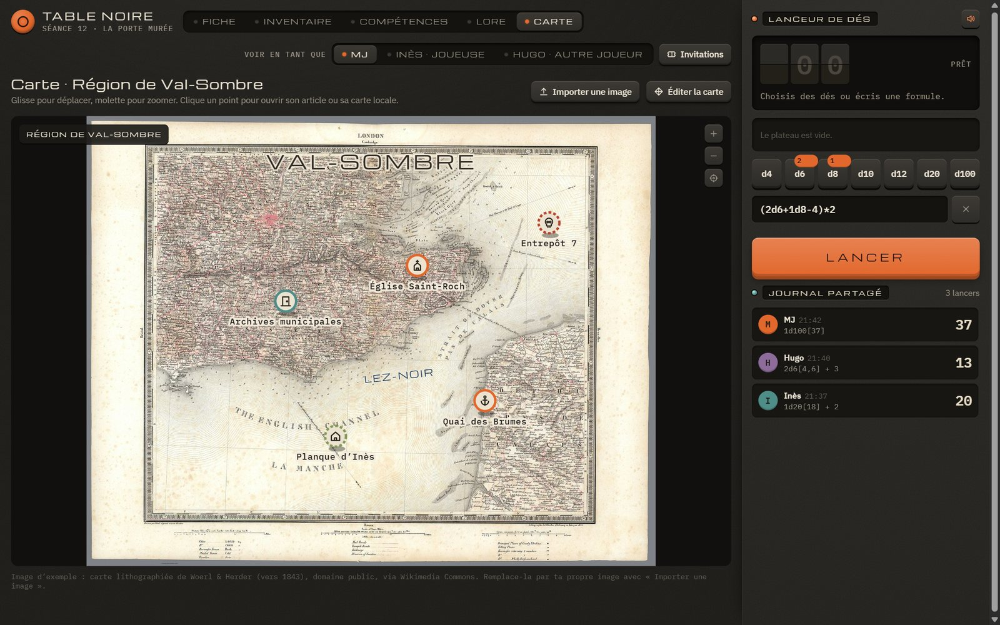
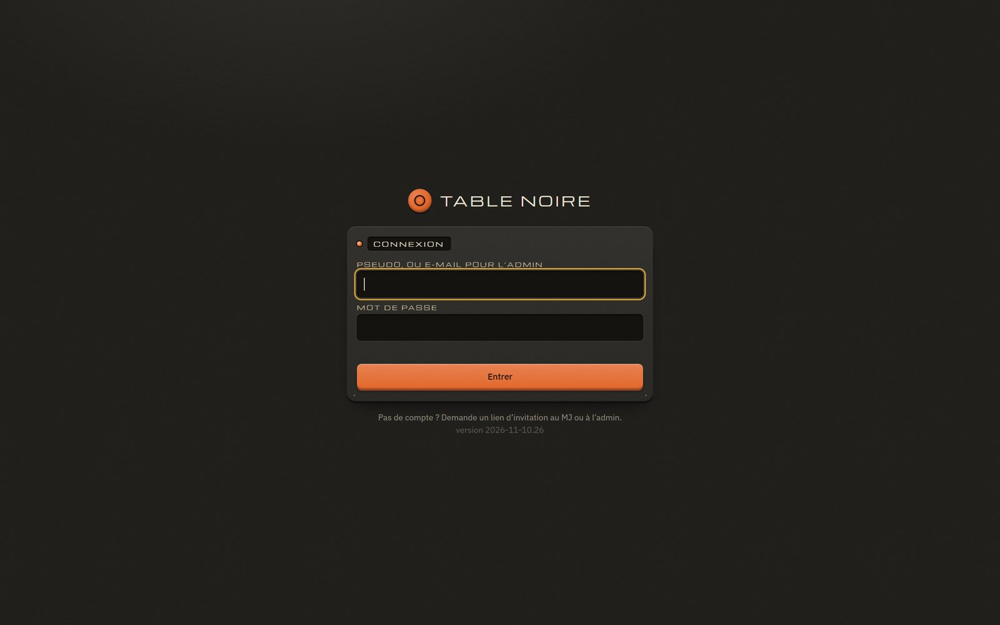
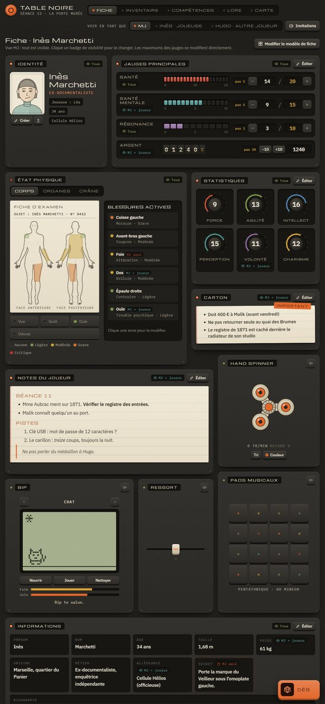
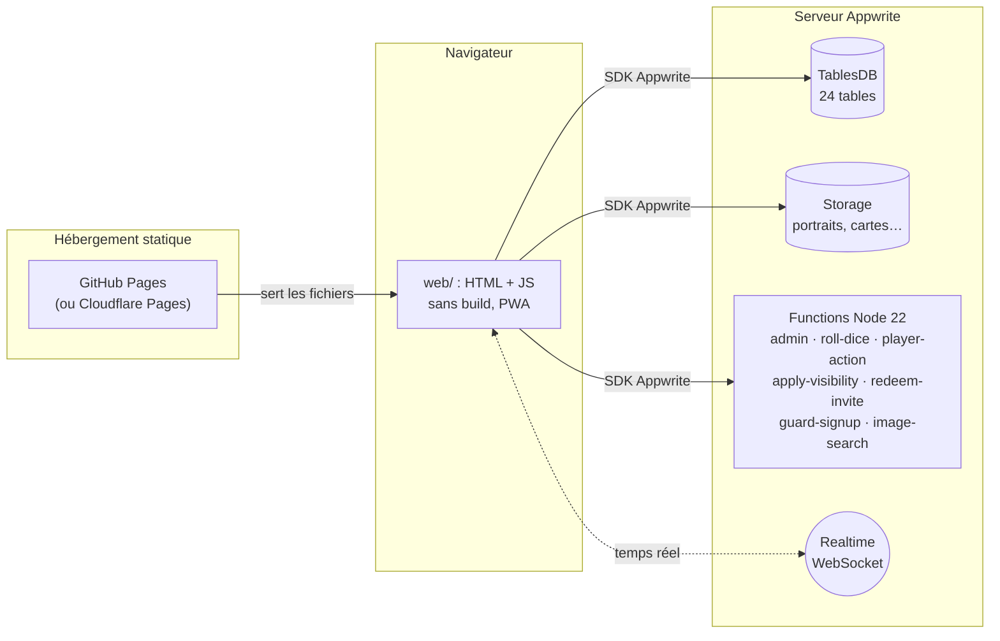

# Table Noire

[English](README.md) · **Français**

**Compagnon de jeu de rôle multi-campagne, en temps réel, pour le MJ et ses joueurs.**
Fiches de personnage modulaires, inventaire et équipement, compétences, lore en Markdown, cartes avec brouillard
de guerre, lanceur de dés partagé, PNJ et ordre de jeu, carnets privés. Une application web installable (PWA),
sans étape de build, hébergée gratuitement sur GitHub Pages, avec un serveur [Appwrite](https://appwrite.io) comme
backend.



> Les captures montrent les données de démonstration fournies avec le projet (personnages et lieux fictifs).

---

## Sommaire

1. [Fonctionnalités](#fonctionnalités)
2. [Aperçu](#aperçu)
3. [Comment ça marche](#comment-ça-marche)
4. [Installation : GitHub Pages + Appwrite](#installation--github-pages--appwrite)
5. [Premiers pas dans l'application](#premiers-pas-dans-lapplication)
6. [Mettre à jour](#mettre-à-jour)
7. [Développement](#développement)
8. [Sécurité](#sécurité)
9. [Dépannage](#dépannage)
10. [Et Supabase ?](#et-supabase-)

---

## Fonctionnalités

**Campagnes et comptes**
- Plusieurs campagnes indépendantes, chacune avec son MJ ; un même compte peut être MJ ici et joueur ailleurs.
- Inscription uniquement sur **lien d'invitation** (à usage unique) ; un administrateur gère comptes et campagnes.
- Liens de réinitialisation de mot de passe générés par l'admin (aucun serveur mail requis).

**Fiche de personnage**
- Fiche en tuiles « bento » réorganisables : identité et portrait, jauges (santé, ressources, argent…),
  statistiques à cadrans, état physique (silhouette, organes, crâne) avec blessures localisées, notes, informations.
- **Modèles de fiche** partagés entre tous les utilisateurs du serveur.
- Visibilité par champ : *tous*, *MJ + propriétaire* ou *MJ seul*, appliquée côté serveur.
- Historique des modifications consultable par le MJ.

**Inventaire, équipement, compétences**
- Bibliothèque d'objets et de compétences par campagne, avec recherche, filtres et tri, import / export sans
  doublons.
- Objets empilables, raretés, objets cachés aux joueurs, don d'objets entre personnages, utilisation d'une unité.
- Onglet **Équipement** : vue anatomique avec emplacements (tête, corps, doigts, oreilles…), capacités modifiables
  et emplacements personnalisés.

**Monde**
- **Lore** : articles en Markdown avec images, articles secrets, recherche avancée (`"phrase exacte"`, `-exclure`).
- **Cartes** : import d'image, points d'intérêt reliés au lore, textes, **brouillard de guerre** dévoilé par le MJ.
- Révélations : le MJ pousse une image ou un texte à l'écran des joueurs.

**À la table**
- **Lanceur de dés** partagé en temps réel : formules (`(2d6+1d8-4)*2`), lancers nommés, lancers secrets,
  journal identique pour tous, effaçable par le MJ.
- **Barre de scène** : portraits des personnages et PNJ présents, ordre de jeu réorganisable, tour en cours.
- **Bibliothèque de PNJ** (MJ) : modèles, exemplaires multiples pour les groupes de monstres ; les joueurs ne voient
  que les PNJ présents dans la scène, et seulement leurs informations publiques.
- Journal de séances, **carnets privés** paginés en Markdown pour chaque joueur.

**Images**
- Recadrage manuel à l'import (portraits, illustrations d'objets).
- **Recherche d'images en ligne** dans trois onglets : Wikimedia Commons, Pixabay (clé unique au serveur) et
  DuckDuckGo.

**Langues**
- Interface en **français** et en **anglais**, choisie par l'admin pour tout le serveur (**Paramètres** sur l'écran des
  campagnes, ou **Paramètres du serveur** dans les paramètres de campagne) : automatique (langue de chaque navigateur),
  français ou anglais.
  Les fiches par défaut des nouvelles campagnes sont créées dans la langue choisie.

**Confort et robustesse**
- PWA installable, fonctionne sur téléphone ; reprise automatique des envois hors ligne.
- Sauvegarde et restauration des données depuis l'interface d'administration.
- Export / import d'une campagne ou d'une bibliothèque.

## Aperçu

| Inventaire | Compétences |
|---|---|
|  |  |
| **Lore** | **Carte** |
|  |  |

<details>
<summary>Connexion et fiche complète (widgets)</summary>





</details>

## Comment ça marche



- **Le client** (`web/`) est un site statique : aucun secret, aucune clé API. Il parle à Appwrite avec le SDK web.
- **Une campagne = une équipe Appwrite** (rôles `gm` et `player`). Les permissions de chaque ligne sont posées par
  le serveur (Function `apply-visibility`) selon la visibilité choisie.
- **Toute action sensible passe par une Function** : lancers de dés (tirés côté serveur), actions des joueurs sur
  les données du MJ, administration, invitations.
- Détails : [ARCHITECTURE.md](ARCHITECTURE.md) (modèle de données, permissions, Functions) et
  [web/README.md](web/README.md) (organisation du client).

---

## Installation : GitHub Pages + Appwrite

Durée : environ 30 minutes si tu as déjà un serveur Appwrite. Tu auras besoin de :

- un compte GitHub ;
- un serveur **Appwrite récent, avec TablesDB** (développé et testé avec Appwrite 2.6 ; auto-hébergé ou Appwrite
  Cloud, voir l'étape 1) ;
- sur ton PC : [Git](https://git-scm.com), [Node.js 20+](https://nodejs.org) et
  [Python 3](https://www.python.org) (pour générer la configuration).

### 1. Obtenir un serveur Appwrite

Choisis une option :

- **Auto-hébergé avec Docker** (recommandé, gratuit, sans limite) : suis
  [l'installation officielle](https://appwrite.io/docs/advanced/self-hosting). Il faut un nom de domaine en
  HTTPS pointant vers le serveur, par exemple `appwrite.example.com`.
- **Auto-hébergé sur un NAS avec Portainer et Nginx Proxy Manager** : le guide
  [infra/appwrite/INSTALL.md](infra/appwrite/INSTALL.md) génère une stack Portainer complète.
- **Appwrite Cloud** ([cloud.appwrite.io](https://cloud.appwrite.io)) : rien à installer. Le plan gratuit limite
  le nombre de Functions et d'exécutions ; vérifie qu'il couvre les 7 Functions du projet.

Dans la suite, remplace `https://appwrite.example.com/v1` par l'adresse de ton serveur
(Appwrite Cloud : `https://<région>.cloud.appwrite.io/v1`, indiquée dans les réglages du projet).

### 2. Créer ta copie du dépôt

1. Clique **Fork** en haut de cette page (ou **Use this template**), puis clone ta copie :

   ```bash
   git clone https://github.com/<ton-compte>/<ton-depot>.git
   cd <ton-depot>
   ```

### 3. Créer le projet Appwrite

1. Dans la console Appwrite, **Create project** ; nomme-le « Table Noire ». Note son **Project ID**
   (Settings → Project ID).
2. **Overview → Add platform → Web** : ajoute les noms d'hôte d'où l'application sera servie :
   - `<ton-compte>.github.io` (GitHub Pages),
   - `localhost` et `127.0.0.1` (pour tester sur ton PC),
   - ton domaine personnalisé si tu en utilises un.
3. **Auth → Settings** : laisse la méthode *Email/Password* activée. Les inscriptions libres sont neutralisées par
   la Function `guard-signup` (seuls les comptes invités sont conservés).

### 4. Configurer le dépôt

1. Copie le modèle de configuration :

   ```bash
   cp tn.config.example.json tn.config.json
   ```

2. Remplis `tn.config.json` :

   ```json
   {
     "appwrite": {
       "endpoint": "https://appwrite.example.com/v1",
       "projectId": "ton-project-id",
       "databaseId": "tablenoire"
     },
     "site": "https://<ton-compte>.github.io/<ton-depot>"
   }
   ```

   `databaseId` est un identifiant que tu choisis (lettres minuscules, chiffres, `-`, `_` ; 36 caractères max) :
   la base sera créée avec ce nom.

3. Génère les fichiers qui en dépendent :

   ```bash
   node tools/configure.mjs
   ```

   Le script écrit `web/config.js`, la politique de sécurité du contenu (CSP) de `web/index.html` et
   `web/_headers`, et la configuration Appwrite (`appwrite/appwrite.config.json`, `appwrite/functions/*/src/config.js`).
   Ces identifiants sont publics, ce ne sont pas des secrets.

### 5. Déployer le backend

1. Installe la CLI Appwrite et connecte-la à ton serveur :

   ```bash
   npm install -g appwrite-cli@27.3.0
   appwrite login --endpoint https://appwrite.example.com/v1
   ```

   Elle demande l'e-mail et le mot de passe de **ton compte de la console Appwrite**. Aucune clé API n'est
   nécessaire, et rien n'est enregistré dans le dépôt.

2. Crée la base, les tables et le stockage :

   ```bash
   cd appwrite
   appwrite push tables
   appwrite push buckets
   ```

3. **Crée le compte administrateur de l'application avant les Functions.** `guard-signup` supprime les comptes
   sans le label `admin` ou `member`, l'admin doit donc l'avoir avant que la Function existe :

   ```bash
   appwrite users create --user-id admin --email toi@example.com --password "<mot-de-passe-solide>" --name "Admin"
   appwrite users update-labels --user-id admin --labels admin
   ```

   Tu peux aussi le faire dans la console : **Auth → Create user**, puis, sur la fiche de l'utilisateur,
   **Labels → `admin`**. Évite de taper un mot de passe dans un terminal partagé : l'historique le conserve.

4. Déploie les Functions :

   ```bash
   for f in admin redeem-invite roll-dice player-action apply-visibility guard-signup image-search; do
     appwrite push functions --function-id $f --force --no-logs
   done
   ```

   (Sous PowerShell : `foreach ($f in 'admin','redeem-invite','roll-dice','player-action','apply-visibility','guard-signup','image-search') { appwrite push functions --function-id $f --force --no-logs }`.)

   Attends que chaque Function soit *Ready* dans la console (**Functions**, onglet *Deployments*). Le premier
   build prend une à deux minutes.

5. *(Facultatif)* **Recherche d'images Pixabay** : crée un compte gratuit sur [pixabay.com](https://pixabay.com),
   récupère ta clé sur [pixabay.com/api/docs](https://pixabay.com/api/docs/), puis dans la console :
   **Functions → image-search → Settings → Environment variables → `PIXABAY_KEY`**. Redéploie la Function
   (*Deployments → Redeploy*). Tous les utilisateurs du serveur partagent cette clé, qui ne quitte jamais le serveur.
   Sans clé, les onglets Wikimedia et DuckDuckGo fonctionnent quand même.

### 6. Publier le site sur GitHub Pages

1. Commite la configuration générée :

   ```bash
   cd ..
   git add tn.config.json web/config.js web/index.html web/_headers appwrite/
   git commit -m "Configuration de mon serveur"
   git push
   ```

2. Sur GitHub : **Settings → Pages → Build and deployment → Source : GitHub Actions**.
3. Le workflow [.github/workflows/pages.yml](.github/workflows/pages.yml) publie `web/` à chaque push sur `main`
   (onglet **Actions** pour suivre). Il ne publie rien tant que `web/config.js` contient les valeurs d'exemple.
4. L'application est en ligne sur `https://<ton-compte>.github.io/<ton-depot>/`.

**Domaine personnalisé (recommandé).** Si ton serveur Appwrite est sur `appwrite.example.com`, sers l'application
depuis un sous-domaine du **même domaine** (par exemple `jdr.example.com` : **Settings → Pages → Custom domain**).
Le cookie de session d'Appwrite est alors un cookie « du même site », que les navigateurs ne bloquent pas. Sur
`github.io`, le SDK Appwrite garde la session dans le stockage local du navigateur. Ça fonctionne, mais ce stockage
est moins protégé qu'un cookie. Pense à ajouter le nouveau nom d'hôte dans les plateformes Web du projet Appwrite
(étape 3).

<details>
<summary>Alternative : Cloudflare Pages</summary>

Ajoute à `tn.config.json` :

```json
"cloudflarePages": { "account": "<id-du-compte-cloudflare>", "project": "<nom-du-projet-pages>" }
```

puis connecte Wrangler (`npx wrangler login`). `node tools/release.mjs` déploie alors `web/` et attend que `site`
serve la nouvelle version. Cloudflare applique `web/_headers` (en-têtes de sécurité et cache).

</details>

### 7. Vérifier l'installation

```bash
node tests/e2e.mjs
```

Ce test crée des comptes jetables (admin, joueur), vérifie 39 règles (permissions, invitations, dés,
inventaire, PNJ, recherche d'images…) puis supprime tout ce qu'il a créé. Il utilise la CLI Appwrite connectée à
l'étape 5.

---

## Premiers pas dans l'application

1. Connecte-toi avec l'e-mail du compte admin.
2. Sur l'écran des campagnes : **Campagnes** (gestionnaire) → **Nouvelle campagne**, choisis le MJ (toi, au début).
   Le bouton **Utilisateurs** liste les comptes et génère les liens de réinitialisation de mot de passe.
3. Entre dans la campagne. Le MJ crée les personnages et prépare le modèle de fiche (**Modifier le modèle de fiche**).
4. **Invitations** : crée un lien par joueur et envoie-le. Le joueur choisit un pseudo et un mot de passe ; le lien
   ne sert qu'une fois.
5. Attribue un personnage à chaque joueur. Le reste (lore, cartes, objets, PNJ) se remplit au fil des séances.
6. Sur téléphone : ouvre le site puis **Ajouter à l'écran d'accueil** pour l'installer comme une application.

Pense aux **sauvegardes** : **Outils MJ → Sauvegardes** (visible pour l'admin) crée une copie des données dans le stockage Appwrite et permet
de la télécharger ou de la restaurer. Les fichiers images ne sont pas inclus : sauvegarde aussi le volume Docker
d'Appwrite.

## Mettre à jour

Quand tu modifies le code du client :

```bash
node tools/release.mjs --check   # vérifications seules
node tools/release.mjs           # vérifications + nouveau numéro de version
git commit -am "..." && git push # GitHub Pages publie
```

Le numéro de version (affiché sur l'écran de connexion, dans les `?v=` des scripts et le cache du service worker)
force les navigateurs à recharger les fichiers.

Quand tu modifies le schéma ou une Function : `node tools/configure.mjs`, puis depuis `appwrite/`,
`appwrite push tables` ou `appwrite push functions --function-id <id> --force`, puis `node tests/e2e.mjs`.

Pour récupérer les nouveautés de ce dépôt dans ta copie : **Sync fork** sur GitHub. Ta configuration est dans
`tn.config.json` et les fichiers générés ; si un conflit apparaît sur l'un d'eux, garde ta version et relance
`node tools/configure.mjs`.

## Développement

- **Sans build** : `web/` se sert tel quel. Pour tester en local :

  ```bash
  python -m http.server 8080 --bind 127.0.0.1 --directory web
  ```

  puis ouvre <http://127.0.0.1:8080> (`127.0.0.1` doit figurer dans les plateformes Web du projet Appwrite).
- `mockup/table-noire.html` est la maquette d'origine. Elle fonctionne hors ligne, avec les données de
  démonstration ; l'application `web/` en reprend le rendu et y branche le serveur.
- Ordre de chargement des scripts et mécanisme d'extension : [web/README.md](web/README.md).
- **Traductions** : le code affiche du français ; `web/i18n-en.js` donne l'anglais de chaque texte (clé = texte français,
  `{0}`, `{1}`… pour les valeurs). `node tools/i18n-extract.mjs` liste les textes sans traduction, et
  `tools/release.mjs` refuse de publier tant qu'il en manque.
- Schéma de la base : `appwrite/build_config.py` (lisible, commenté), qui génère `appwrite.config.json`.
- Règles côté serveur : [appwrite/README.md](appwrite/README.md).

```
web/            client (HTML, JS, service worker, CSP)
appwrite/       schéma (build_config.py) et Functions Node 22
tools/          configure.mjs (configuration), release.mjs (vérifications et version)
tests/          e2e.mjs (tests de bout en bout contre ton serveur)
infra/appwrite/ installation d'Appwrite sur un NAS (Portainer)
mockup/         maquette d'origine, hors ligne
docs/           captures d'écran
```

## Sécurité

- Le client ne contient **aucun secret**. Les identifiants de `tn.config.json` (adresse, projet, base) sont publics
  par nature.
- Les **permissions sont appliquées par Appwrite**, pas par l'interface : un joueur ne peut pas lire une valeur
  « MJ seul », même en interrogeant l'API directement.
- Les joueurs ne modifient jamais directement les données du MJ : ils passent par la Function `player-action`, qui
  valide chaque valeur (portraits compris).
- Les dés sont tirés côté serveur.
- CSP stricte : pas de script intégré, bibliothèques externes épinglées avec contrôle d'intégrité (SRI). Le
  Markdown est assaini avec DOMPurify.
- Recherche d'images : la Function ne télécharge que des adresses publiques (jamais le réseau local du serveur) et
  seulement des images de 6 Mo au plus.
- **Ne commite jamais** de clé API, de mot de passe ni de fichier `.env` (`.gitignore` les exclut). Les clés
  facultatives (Pixabay) se règlent dans la console Appwrite.

## Dépannage

| Symptôme | Cause probable |
|---|---|
| Connexion impossible, sans message | Le nom d'hôte du site n'est pas dans les plateformes Web du projet Appwrite. |
| « Invalid Origin » dans la console du navigateur | Même cause : ajoute la plateforme Web. |
| Le compte admin disparaît après sa création | Il n'avait pas le label `admin` dans les 25 s (`guard-signup`). Recrée-le avec le label. |
| Toutes les Functions échouent en 0 s (auto-hébergé) | Docker trop ancien sur le serveur : il faut Docker Engine 25 ou plus (voir infra/appwrite/INSTALL.md). |
| Les joueurs ne voient pas les mises à jour en direct | Le WebSocket Realtime est bloqué par le proxy : autorise l'upgrade WebSocket vers Appwrite. |
| Le workflow Pages ne publie rien (« example values ») | Remplis `tn.config.json`, lance `node tools/configure.mjs`, commite. |
| L'onglet Pixabay dit « pas configuré » | Ajoute `PIXABAY_KEY` à la Function `image-search` puis redéploie-la. |
| DuckDuckGo ne répond pas | Pas d'API officielle : DuckDuckGo refuse parfois les requêtes automatiques. Réessaie plus tard ou utilise un autre onglet. |

## Et Supabase ?

Table Noire fonctionne **uniquement avec Appwrite**. Le serveur repose sur des briques propres à Appwrite :
équipes et rôles, permissions par ligne posées par des Functions déclenchées sur événement, Realtime, Functions
avec clé temporaire. Un portage vers Supabase (Postgres + RLS, Edge Functions, Realtime) est envisageable, mais il
n'existe pas aujourd'hui.

## Licence

[MIT](LICENSE).
