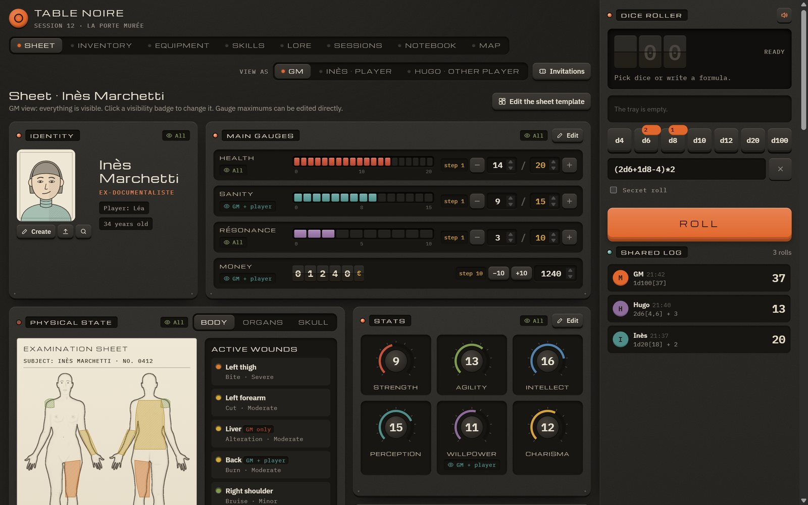
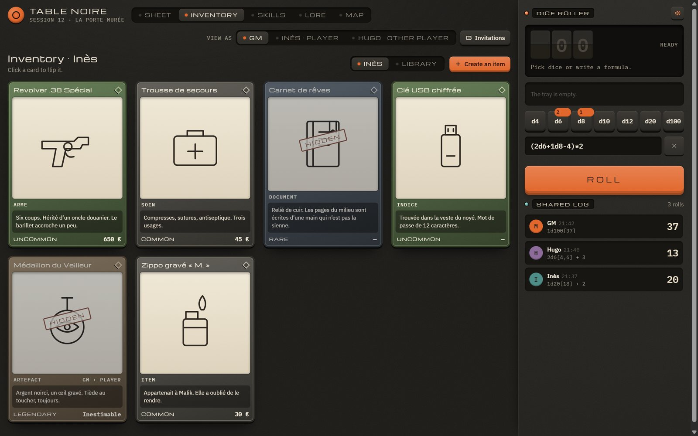
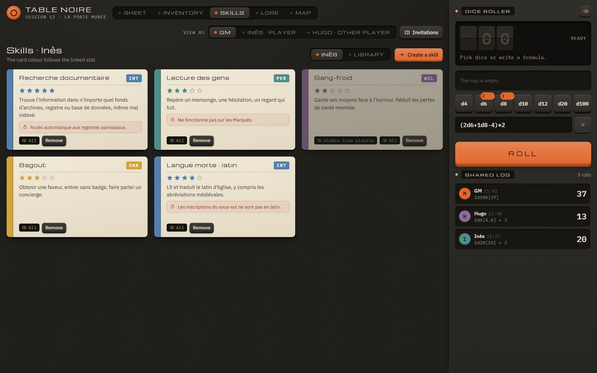
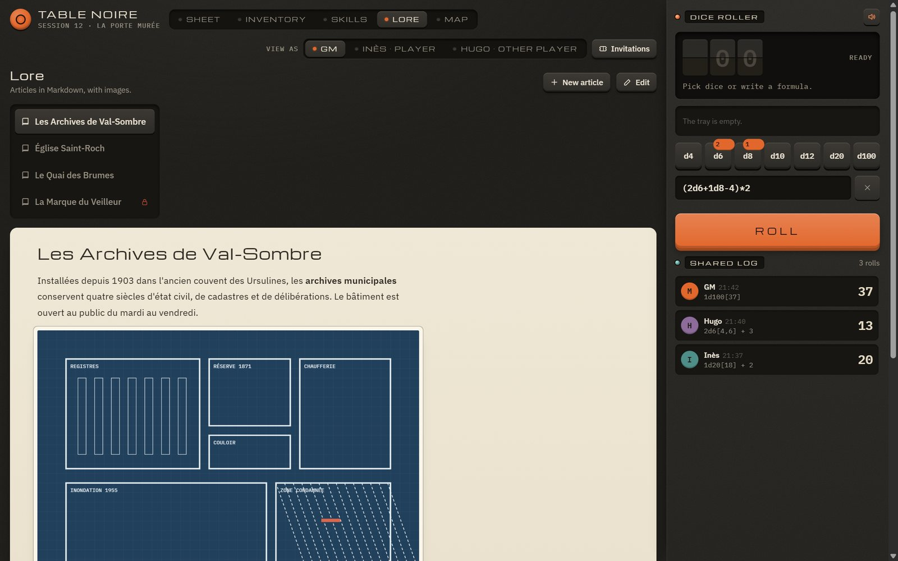
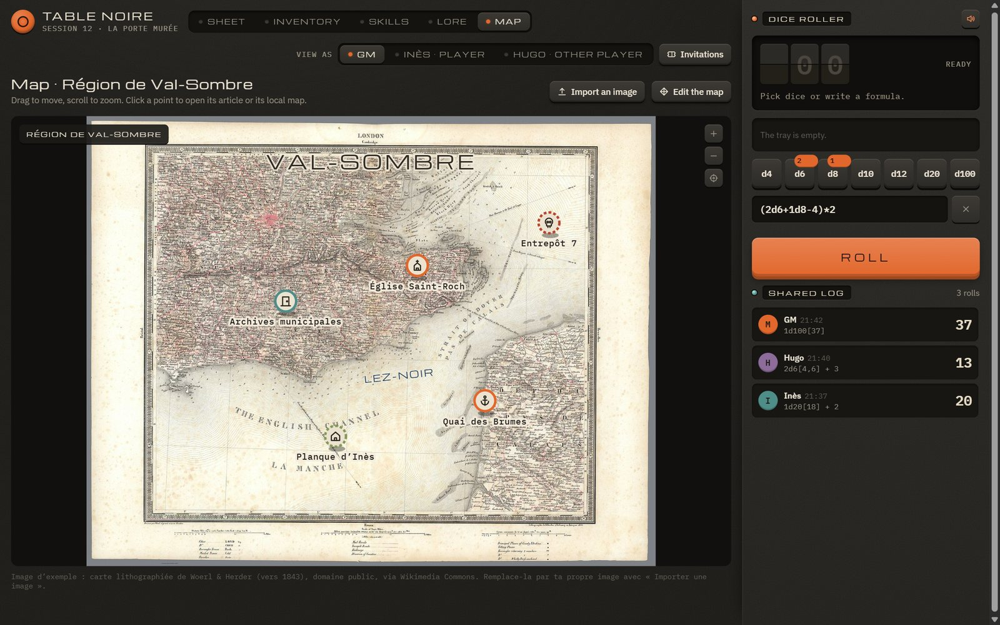
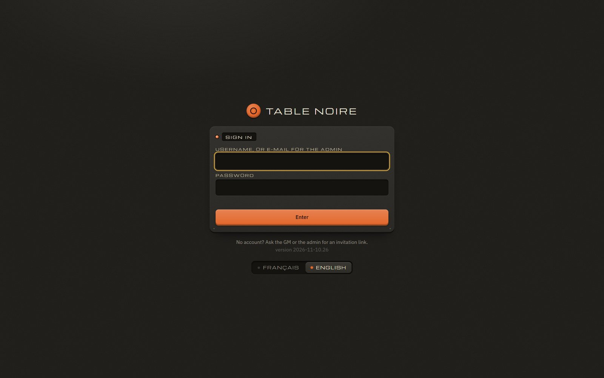
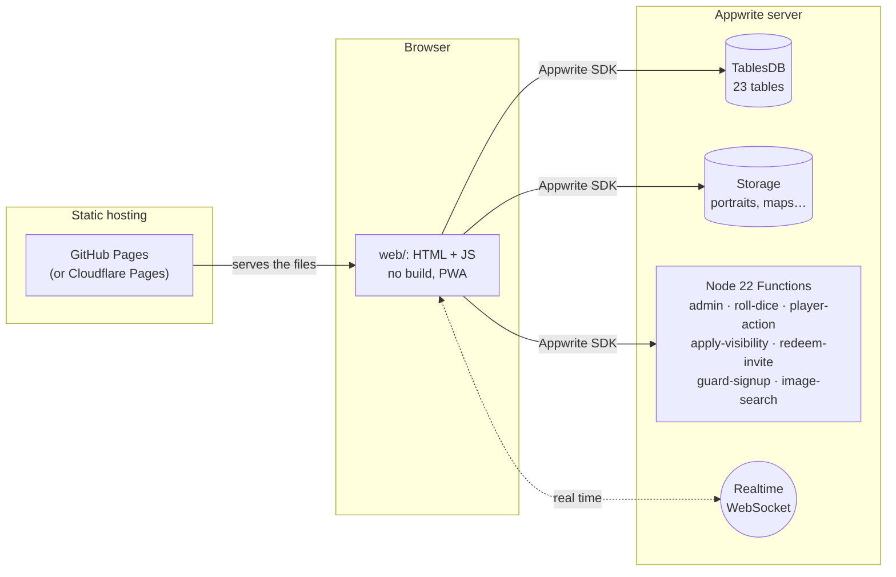

# Table Noire

**English** · [Français](README.fr.md)

**A real-time, multi-campaign tabletop RPG companion for the GM and their players.**
Modular character sheets, inventory and equipment, skills, Markdown lore, maps with fog of war, a shared dice
roller, NPCs and turn order, private notebooks. An installable web app (PWA) with no build step, hosted for free on
GitHub Pages, with an [Appwrite](https://appwrite.io) server as its backend. Interface in English and French.



> The screenshots show the demo data shipped with the project (fictional characters and places, written in French).

---

## Contents

1. [Features](#features)
2. [Screenshots](#screenshots)
3. [How it works](#how-it-works)
4. [Installation: GitHub Pages + Appwrite](#installation-github-pages--appwrite)
5. [First steps in the app](#first-steps-in-the-app)
6. [Updating](#updating)
7. [Development](#development)
8. [Security](#security)
9. [Troubleshooting](#troubleshooting)
10. [What about Supabase?](#what-about-supabase)

---

## Features

**Campaigns and accounts**
- Several independent campaigns, each with its own GM; the same account can be GM in one and player in another.
- Sign-up only through a single-use **invitation link**; an administrator manages accounts and campaigns.
- Password reset links generated by the admin (no mail server needed).

**Character sheet**
- “Bento” tiles you can rearrange: identity and portrait, gauges (health, resources, money…), dial stats, physical
  state (silhouette, organs, skull) with located wounds, notes, information.
- **Sheet templates** shared by every user of the server.
- Per-field visibility: *everyone*, *GM + owner* or *GM only*, enforced by the server.
- Change history the GM can browse and roll back.

**Inventory, equipment, skills**
- Item and skill library per campaign, with search, filters and sorting, import / export without duplicates.
- Stackable items, rarities, items hidden from players, giving items between characters, using one unit.
- **Equipment** tab: anatomical view with slots (head, body, fingers, ears…), editable capacities and custom slots.

**World**
- **Lore**: Markdown articles with images, secret articles, advanced search (`"exact phrase"`, `-exclude`).
- **Maps**: image import, points of interest linked to the lore, labels, **fog of war** revealed by the GM.
- Reveals: the GM pushes an image or a text to the players’ screens.

**At the table**
- Real-time shared **dice roller**: formulas (`(2d6+1d8-4)*2`), named rolls, secret rolls, the same log for everyone,
  which the GM can clear.
- **Scene bar**: portraits of the characters and NPCs present, reorderable turn order, current turn.
- **NPC library** (GM): templates and multiple copies for groups of monsters; players only see the NPCs in the scene,
  and only their public information.
- Session log, paginated Markdown **private notebooks** for each player.

**Images**
- Manual crop on import (portraits, item illustrations).
- **Online image search** in three tabs: Wikimedia Commons, Pixabay (one key per server) and DuckDuckGo.

**Languages**
- **English** and **French** interface: pick it on the sign-in screen (browser language by default). The default
  sheet of a new campaign is created in the chosen language.

**Comfort and robustness**
- Installable PWA, works on phones; offline changes are sent again automatically.
- Backup and restore of the data from the admin interface.
- Export / import of a campaign or a library.

## Screenshots

| Inventory | Skills |
|---|---|
|  |  |
| **Lore** | **Map** |
|  |  |

<details>
<summary>Sign-in screen</summary>



</details>

## How it works



- **The client** (`web/`) is a static site: no secret, no API key. It talks to Appwrite with the web SDK.
- **A campaign is an Appwrite team** (roles `gm` and `player`). Each row’s permissions are set by the server
  (`apply-visibility` Function) from the visibility chosen.
- **Every sensitive action goes through a Function**: dice rolls (rolled server-side), player actions on GM data,
  administration, invitations.
- Details (in French): [ARCHITECTURE.md](ARCHITECTURE.md) (data model, permissions, Functions) and
  [web/README.md](web/README.md) (client layout).

---

## Installation: GitHub Pages + Appwrite

About 30 minutes if you already have an Appwrite server. You need:

- a GitHub account;
- a **recent Appwrite server with TablesDB** (developed and tested with Appwrite 2.6; self-hosted or Appwrite Cloud,
  see step 1);
- on your computer: [Git](https://git-scm.com), [Node.js 20+](https://nodejs.org) and
  [Python 3](https://www.python.org) (to generate the configuration).

### 1. Get an Appwrite server

Pick one:

- **Self-hosted with Docker** (recommended, free, no limits): follow
  [the official installation](https://appwrite.io/docs/advanced/self-hosting). You need a domain name in HTTPS
  pointing to the server, for example `appwrite.example.com`.
- **Self-hosted on a NAS with Portainer and Nginx Proxy Manager**: the guide
  [infra/appwrite/INSTALL.md](infra/appwrite/INSTALL.md) (in French) generates a complete Portainer stack.
- **Appwrite Cloud** ([cloud.appwrite.io](https://cloud.appwrite.io)): nothing to install. The free plan limits the
  number of Functions and executions; check that it covers the project’s 7 Functions.

Below, replace `https://appwrite.example.com/v1` with your server address
(Appwrite Cloud: `https://<region>.cloud.appwrite.io/v1`, shown in the project settings).

### 2. Make your copy of the repository

Click **Fork** at the top of this page (or **Use this template**), then clone your copy:

```bash
git clone https://github.com/<your-account>/<your-repo>.git
cd <your-repo>
```

### 3. Create the Appwrite project

1. In the Appwrite console, **Create project**; name it “Table Noire”. Note its **Project ID**
   (Settings → Project ID).
2. **Overview → Add platform → Web**: add the host names the app will be served from:
   - `<your-account>.github.io` (GitHub Pages),
   - `localhost` and `127.0.0.1` (to test on your computer),
   - your custom domain if you use one.
3. **Auth → Settings**: keep the *Email/Password* method enabled. Open sign-ups are neutralised by the
   `guard-signup` Function (only invited accounts are kept).

### 4. Configure the repository

1. Copy the configuration template:

   ```bash
   cp tn.config.example.json tn.config.json
   ```

2. Fill in `tn.config.json`:

   ```json
   {
     "appwrite": {
       "endpoint": "https://appwrite.example.com/v1",
       "projectId": "your-project-id",
       "databaseId": "tablenoire"
     },
     "site": "https://<your-account>.github.io/<your-repo>"
   }
   ```

   `databaseId` is an identifier you choose (lowercase letters, digits, `-`, `_`; 36 characters max): the database
   is created with this name.

3. Generate the files that depend on it:

   ```bash
   node tools/configure.mjs
   ```

   The script writes `web/config.js`, the content security policy (CSP) of `web/index.html` and `web/_headers`, and
   the Appwrite configuration (`appwrite/appwrite.config.json`, `appwrite/functions/*/src/config.js`). These
   identifiers are public, not secrets.

### 5. Deploy the backend

1. Install the Appwrite CLI and sign it in to your server:

   ```bash
   npm install -g appwrite-cli@27.3.0
   appwrite login --endpoint https://appwrite.example.com/v1
   ```

   It asks for the e-mail and password of **your Appwrite console account**. No API key is needed and nothing is
   stored in the repository.

2. Create the database, the tables and the storage:

   ```bash
   cd appwrite
   appwrite push tables
   appwrite push buckets
   ```

3. **Create the app’s administrator account before the Functions.** `guard-signup` deletes accounts without the
   `admin` or `member` label, so the admin must have it before the Function exists:

   ```bash
   appwrite users create --user-id admin --email you@example.com --password "<a-strong-password>" --name "Admin"
   appwrite users update-labels --user-id admin --labels admin
   ```

   You can also do it in the console: **Auth → Create user**, then on the user’s page, **Labels → `admin`**. Avoid
   typing a password in a shared terminal: its history keeps it.

4. Deploy the Functions:

   ```bash
   for f in admin redeem-invite roll-dice player-action apply-visibility guard-signup image-search; do
     appwrite push functions --function-id $f --force --no-logs
   done
   ```

   (PowerShell: `foreach ($f in 'admin','redeem-invite','roll-dice','player-action','apply-visibility','guard-signup','image-search') { appwrite push functions --function-id $f --force --no-logs }`.)

   Wait until every Function is *Ready* in the console (**Functions**, *Deployments* tab). The first build takes one
   or two minutes.

5. *(Optional)* **Pixabay image search**: create a free account on [pixabay.com](https://pixabay.com), get your key
   from [pixabay.com/api/docs](https://pixabay.com/api/docs/), then in the console:
   **Functions → image-search → Settings → Environment variables → `PIXABAY_KEY`**. Redeploy the Function
   (*Deployments → Redeploy*). Every user of the server shares this key, which never leaves the server. Without a
   key, the Wikimedia and DuckDuckGo tabs still work.

### 6. Publish the site on GitHub Pages

1. Commit the generated configuration:

   ```bash
   cd ..
   git add tn.config.json web/config.js web/index.html web/_headers appwrite/
   git commit -m "Configuration for my server"
   git push
   ```

2. On GitHub: **Settings → Pages → Build and deployment → Source: GitHub Actions**.
3. The workflow [.github/workflows/pages.yml](.github/workflows/pages.yml) publishes `web/` at every push to `main`
   (follow it in the **Actions** tab). It publishes nothing while `web/config.js` still holds the example values.
4. The app is online at `https://<your-account>.github.io/<your-repo>/`.

**Custom domain (recommended).** If your Appwrite server is on `appwrite.example.com`, serve the app from a
subdomain of the **same domain** (for example `rpg.example.com`: **Settings → Pages → Custom domain**). Appwrite’s
session cookie is then a same-site cookie, which browsers do not block. On `github.io`, the Appwrite SDK keeps the
session in the browser’s local storage instead: it works, but that storage is less protected than a cookie. Add the
new host name to the Web platforms of the Appwrite project (step 3).

<details>
<summary>Alternative: Cloudflare Pages</summary>

Add to `tn.config.json`:

```json
"cloudflarePages": { "account": "<cloudflare-account-id>", "project": "<pages-project-name>" }
```

then sign in Wrangler (`npx wrangler login`). `node tools/release.mjs` then deploys `web/` and waits until `site`
serves the new version. Cloudflare applies `web/_headers` (security and cache headers).

</details>

### 7. Check the installation

```bash
node tests/e2e.mjs
```

This test creates throwaway accounts (admin, player), checks 39 rules (permissions, invitations, dice, inventory,
NPCs, image search…), then deletes everything it created. It uses the Appwrite CLI signed in at step 5.

---

## First steps in the app

1. Sign in with the admin account’s e-mail.
2. On the campaigns screen: **Campaigns** (manager) → **New campaign**, and pick the GM (you, to start with).
   The **Users** button lists the accounts and generates password reset links.
3. Enter the campaign. The GM creates the characters and prepares the sheet template (**Edit the sheet template**).
4. **Invitations**: create one link per player and send it. The player picks a username and a password; the link
   works once.
5. Assign a character to each player. The rest (lore, maps, items, NPCs) fills up over the sessions.
6. On a phone: open the site, then **Add to Home Screen** to install it as an app.

Think about **backups**: **GM tools → Backups** (visible to the admin) makes a copy of the data in Appwrite storage
and lets you download or restore it. Image files are not included: back up Appwrite’s Docker volume as well.

## Updating

When you change the client code:

```bash
node tools/release.mjs --check   # checks only
node tools/release.mjs           # checks + new version number
git commit -am "..." && git push # GitHub Pages publishes
```

The version number (shown on the sign-in screen, in the scripts’ `?v=` and in the service worker cache) forces
browsers to load the new files.

When you change the schema or a Function: `node tools/configure.mjs`, then from `appwrite/`,
`appwrite push tables` or `appwrite push functions --function-id <id> --force`, then `node tests/e2e.mjs`.

To bring this repository’s updates into your copy: **Sync fork** on GitHub. Your configuration lives in
`tn.config.json` and the generated files; if one of them conflicts, keep your version and run
`node tools/configure.mjs` again.

## Development

- **No build**: `web/` is served as is. To test locally:

  ```bash
  python -m http.server 8080 --bind 127.0.0.1 --directory web
  ```

  then open <http://127.0.0.1:8080> (`127.0.0.1` must be among the Web platforms of the Appwrite project).
- `mockup/table-noire.html` is the original mockup. It works offline with the demo data; the `web/` app reuses its
  rendering and plugs the server in.
- Script load order and extension mechanism: [web/README.md](web/README.md).
- **Translations**: the code shows French text; `web/i18n-en.js` gives the English for each text (key = French
  text, `{0}`, `{1}`… for values), applied to the page by `web/i18n.js`. `node tools/i18n-extract.mjs` lists the
  texts without a translation, and `tools/release.mjs` refuses to publish while any is missing.
- Database schema: `appwrite/build_config.py` (readable, commented), which generates `appwrite.config.json`.
- Server-side rules: [appwrite/README.md](appwrite/README.md).

```
web/            client (HTML, JS, service worker, CSP, translations)
appwrite/       schema (build_config.py) and Node 22 Functions
tools/          configure.mjs (configuration), release.mjs (checks and version), i18n-extract.mjs (translations)
tests/          e2e.mjs (end-to-end tests against your server)
infra/appwrite/ Appwrite installation on a NAS (Portainer)
mockup/         original mockup, offline
docs/           screenshots
```

## Security

- The client holds **no secret**. The identifiers in `tn.config.json` (address, project, database) are public by
  nature.
- **Permissions are enforced by Appwrite**, not by the interface: a player cannot read a “GM only” value, even by
  calling the API directly.
- Players never change GM data directly: they go through the `player-action` Function, which validates every value
  (portraits included).
- Dice are rolled on the server.
- Strict CSP: no inline script, external libraries pinned with integrity checks (SRI). Markdown is sanitised with
  DOMPurify.
- Image search: the Function only downloads public addresses (never the server’s local network) and only images of
  6 MB at most.
- **Never commit** an API key, a password or a `.env` file (`.gitignore` excludes them). Optional keys (Pixabay) are
  set in the Appwrite console.

## Troubleshooting

| Symptom | Likely cause |
|---|---|
| Cannot sign in, no message | The site’s host name is not in the Web platforms of the Appwrite project. |
| “Invalid Origin” in the browser console | Same cause: add the Web platform. |
| The admin account disappears after creation | It did not get the `admin` label within 25 s (`guard-signup`). Create it again with the label. |
| Every Function fails in 0 s (self-hosted) | Docker too old on the server: Docker Engine 25 or later is needed (see infra/appwrite/INSTALL.md). |
| Players do not see live updates | The Realtime WebSocket is blocked by the proxy: allow WebSocket upgrades to Appwrite. |
| The Pages workflow publishes nothing (“example values”) | Fill in `tn.config.json`, run `node tools/configure.mjs`, commit. |
| The Pixabay tab says “not configured” | Add `PIXABAY_KEY` to the `image-search` Function, then redeploy it. |
| DuckDuckGo does not answer | No official API: DuckDuckGo sometimes refuses automated requests. Try again later or use another tab. |

## What about Supabase?

Table Noire works **with Appwrite only**. The server relies on features specific to Appwrite: teams and roles,
row permissions set by event-triggered Functions, Realtime, Functions with a temporary key. A port to Supabase
(Postgres + RLS, Edge Functions, Realtime) is possible, but it does not exist today.

## Licence

[MIT](LICENSE).
